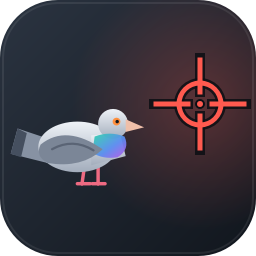

<p align="center"></p>

# PigeonCrosshair

**EN** — A free, open-source crosshair overlay for Windows. It draws a transparent, click-through crosshair above any window (windowed and borderless games), with a live preview, multi-monitor support and a system-tray menu. Built with C++ and Qt 6.

**IT** — Overlay mirino gratuito e open source per Windows. Disegna un mirino trasparente, che lascia passare i click, sopra qualsiasi finestra (giochi in finestra e borderless), con anteprima live, multi-monitor e menu nella tray. Fatto con C++ e Qt 6.

🌐 **Website / Sito:** https://vale-dev48.github.io/PigeonCrosshair/
⬇️ **Download:** [latest release](https://github.com/vale-dev48/PigeonCrosshair/releases/latest)

## Features / Funzioni

- Crosshairs: Cross, wide Chevron, centered Line, Pigeon, Dot — color, opacity, size, thickness, gap, outline
- Custom PNG/SVG images: scale, rotation, tint, X/Y offset
- Multi-monitor with per-monitor DPI
- System tray: show/hide, switch preset, open settings, quit
- User presets, saved in `%APPDATA%\PigeonCrosshair\PigeonCrosshair.ini`

## Limits / Limiti

- Exclusive-fullscreen games hide every overlay: use borderless / windowed. / I giochi in fullscreen esclusivo nascondono ogni overlay: usa borderless o finestra.
- Some anti-cheat systems may dislike overlays. The app only draws its own window and never touches the game, but use it at your own risk. / Alcuni anti-cheat possono non gradire gli overlay. Usalo a tuo rischio.
- The binary is unsigned, so Windows SmartScreen may warn. / L'exe non è firmato: SmartScreen può avvisare.

## Build

Requirements: Qt 6.5+ (tested with 6.12, MinGW 64-bit), CMake 3.21+, Ninja.

```powershell
.\build.ps1 -Run        # configure + build (+ run); edit the Qt path at the top of the script if needed
.\package.ps1           # dist\PigeonCrosshair-win64.zip
```

Or by hand:

```
cmake -S . -B build -G Ninja -DCMAKE_BUILD_TYPE=Release -DCMAKE_PREFIX_PATH=C:/Qt/6.12.0/mingw_64
cmake --build build
```

## How the overlay works

- Qt flags `WindowStaysOnTop | WindowTransparentForInput | WindowDoesNotAcceptFocus`, plus Win32 `WS_EX_LAYERED | WS_EX_TRANSPARENT | WS_EX_TOOLWINDOW | WS_EX_NOACTIVATE`.
- `SetWindowPos(HWND_TOPMOST)` is re-applied every second.
- The window is only as big as the crosshair and centered on the chosen monitor; the screen is set before the geometry so per-monitor DPI is correct.
- One renderer (`CrosshairRenderer`) draws overlay, preview and icons.

## Project layout

| File | Role |
|---|---|
| `src/CrosshairConfig` | parameters = preset, JSON |
| `src/CrosshairRenderer` | all drawing |
| `src/ConfigStore` | state, presets, persistence |
| `src/OverlayWindow` | click-through always-on-top window |
| `src/SettingsWindow`, `PreviewWidget`, `Widgets` | UI |
| `src/TrayController`, `AppController` | tray and wiring |
| `docs/` | website (GitHub Pages) |

## Contributing

Issues and pull requests are welcome. / Issue e pull request sono benvenute.

## License

[MIT](LICENSE). The binary release bundles Qt (LGPLv3): see [THIRD-PARTY-NOTICES.md](THIRD-PARTY-NOTICES.md).
